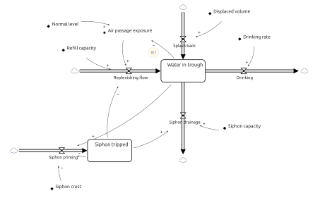
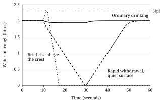
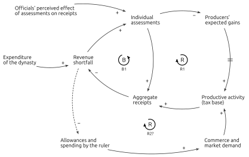
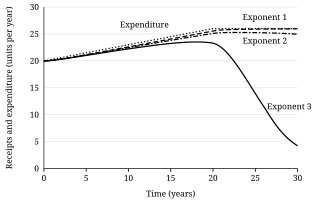
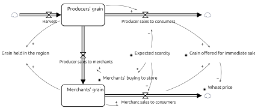
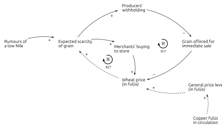
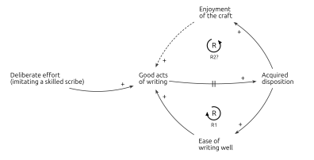
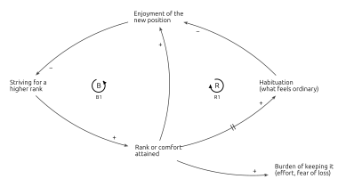
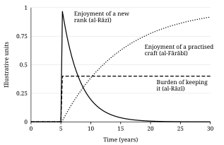

# Systems Thinking in Medieval Arabic Scholarship

*An evidential standard for reading feedback in historical sources*

**Amin Al Yaquob** · Draft of 25 November 2026

> Mobile edition: condensed summary of the preprint draft. Not peer reviewed. Pinch to zoom on figures. Full references and Appendix B are in the original.

## Abstract

When may a medieval explanation be read as a description of feedback? This paper grades each causal link by the kind of evidence behind it, and pairs it with an observation that would change the reading.

It is applied to five cases: a ninth-century trough, Ibn Khaldūn's fiscal argument, Cairo's grain market in 1433, habituation in al-Ghazālī, al-Fārābī and al-Rāzī, and the sources' own validation methods.

Causal loop diagrams, stock-and-flow diagrams, four illustrative simulations and a link-level ledger keep every claim and its status visible.

**Keywords:** feedback control; history of system dynamics; causal loop diagrams; policy resistance; Laffer curve; Mamluk Egypt.

## 1. Introduction: what counts as evidence of feedback?

A fiscal authority raises the levy because revenue fell. Producers withdraw. Receipts fall further, so the authority raises the levy *again*. That word *again* turns one decision's outcome into the next decision's input: an information feedback loop. Ibn Khaldūn supplied this link in the *Muqaddimah* (14th century), without any diagram or equations.

Two claims need different evidence:

- **Comparable mechanisms**: the question here.
- **Transmission** (a later thinker inherited the idea): not shown. No direct medieval influence on Forrester is established.

Prior work exists: Mayr (1970) and Bir (1990) on engineering; Chapra, Hussain, Laffer and Turchin on Ibn Khaldūn; Meloy, Shoshan and Allouche on Mamluk economics.

**The question:** when historical material is translated into a model, what evidence warrants each causal link?

## 2. Sources and method

The corpus is a purposive sample from searches on 25 November 2026. Each candidate case scored 0 to 2 on four criteria:

- the source states the causal return itself;
- the passage can be checked in Arabic or a scholarly translation;
- the case teaches something new;
- it can be drawn as a diagram or simple model.

Cases scoring 6 or more of 8 are in the main text. The rest are listed in Appendix A.

The unit of analysis is the **causal link**. For each: the behavior, what changes, the textual or material basis, and a discriminating observation.

| Grade | Meaning | Example |
|---|---|---|
| E1 | Source states the rule or claim | Officials raise levies on seeing a shortfall |
| E2 | Source reports behavior; cause is the author's | Rumor-spreaders raised the 1433 price |
| E3 | Material reconstruction by modern scholars | Hydraulic reading of Device 7 |
| E4 | Inferred from modern scholarship or data | Annual price regression |
| E5 | Modeler's addition, no source | Target inventory |

Figures are qualitative maps. Every link has a sign. Links graded E5 are **dashed**. Four figures add illustrative simulations whose parameters are assumptions, not estimates.

## 3. The Banū Mūsā trough

Device 7 of *Kitāb al-Ḥiyal* (9th-century Baghdad) keeps its water level constant when small animals drink, yet empties when a large animal drinks.

*Figure 1. Device 7 as stock and flow (after Bir and Kaçar, 2006). B1: a falling level exposes the air passage, raising inflow. Threshold regime: above the siphon crest, the siphon primes, drains the trough and cuts off refill.*

**Two regimes:** ordinary balancing regulation (B1), and a threshold that disables it and opens a second outflow.

**Two rival readings:**

- *Refill-capacity:* the bull simply withdraws faster than refill. The level **falls** before failure, and the trough **refills** once drinking stops.
- *Siphon:* a transient **rise** over the crest primes the siphon. The trough **stays empty** until water is added from outside.

**Proposed test:** measure the direction of change just before emptying, and whether the trough recovers. This is a proposal, not a new trial.

*Figure 2. Illustrative simulation (assumed numbers). A rapid withdrawal refills; a brief rise above the crest empties the trough and it stays empty.*

## 4. Ibn Khaldūn: a decision rule and a misperceived loop

*Muqaddimah* III.36 states the pattern: early in a dynasty, assessments are low and receipts large; late, assessments are high and receipts small. Then, in one sentence:

> Officials **may** raise levies when they see the shortfall, reckoning it a remedy, until every levy reaches a limit beyond which there is no gain. The total keeps falling while levies keep rising, because of their belief that the total can be restored by them. (author's translation)

**Three model elements:**

1. **Cue and action:** a shortfall prompts a rise. The word *may* (ربما) matters: not an unconditional rule.
2. **Mental model:** officials perceive only the immediate balancing effect (B1), a misperception **stated by the source** (E1).
3. **Persistence and a limit:** the Laffer-type revenue peak.

*Figure 3. B1 (balancing): a higher assessment raises receipts now. R1 (reinforcing): it lowers producers' expected gains; after a delay, activity contracts and the shortfall grows. R2? (from §40): the dashed link, a shortfall leading the ruler to cut allowances, is the modeler's (E5).*

**Short run versus long run.** Raising 20% to 25% on a base of 100 lifts revenue from 20 to 25. Revenue falls below the original only if the base falls under 80.

Let revenue R = τB. If the base settles at B*(τ) = B₀((1−τ)/(1−τ₀))^ε, steady revenue peaks at τ* = 1/(1+ε).

- Demand **below** the peak: a rule raising rates can close the gap (B1 prevails).
- Demand **above** the peak: no rate closes it; R1 must eventually dominate.
- The delay governs only **when** this shows in receipts.

*Figure 4. Illustrative simulation: expenditure grows from 20 to 26; officials raise the rate by at most 5 points a year, to 80%. Curves show ε = 1, 2, 3.*

| ε | Peak revenue | Year 30 | Outcome |
|---|---|---|---|
| 1 | 31.2 | 26.0 | gap closed |
| 2 | 23.1 | 25.0 | decline |
| 3 | 20.6 | 4.2 | collapse |

Loop-dominance analysis (Loops That Matter) shows R1 overtaking B1 between years 4 and 5, over a decade before receipts peak. The misperception is plausible: for years the rule appears to work while the loop that will defeat it already dominates.

The size of ε is an empirical question for fiscal and agrarian records. The text does not settle it.

**Modern formalizations differ.** Hussain (1993) is analytic with no decision rule. Korotayev holds area and technology fixed. Chapra is verbal. Firouzian (2025) is an abstract only. This paper adds the officials' belief and a delayed base.

## 5. Cairo in 1433: grain held, grain offered, and the coin

In Dhū al-Qaʿdah 836 AH (June to July 1433), wheat rose 30%, from 100 to 130 dirhams fulūs per irdabb. Al-Maqrīzī reports that people of means spread rumors that the Nile would not reach plenitude; producers withheld sales and merchants bought to store (via Meloy, 2005).

**Stock logic.** A purchase by merchants only moves grain between two stocks, so regional grain does not change. What reaches the market is the grain **offered** for sale. Subtracting purchases from regional stocks would manufacture a shortage.

*Figure 5. Grain held versus grain offered. Structure only; no quantities.*

**What the source supports:** the forward path from rumor to expected scarcity, to withholding and buying, to price. **What it does not:** the return link from higher price to stronger expectations. Only if that holds do two reinforcing loops close (R1?, R2?).

*Figure 6. Solid: reported forward path. Dashed: the unestablished return link, and the monetary input (copper fulūs raising all fulūs prices).*

**A rival with no feedback.** Prices were quoted in copper fulūs, a debased coin. Al-Maqrīzī himself blamed copper for high prices in *Ighāthat al-umma*. Meloy notes other commodities rose too. The test is therefore the **relative** price of wheat, against other goods or in gold and silver.

**Rival explanations and their discriminating records**

- **Physical supply:** wheat-specific rise as the poor crop reaches market. Test with Nilometer readings, harvest timing, arrivals.
- **Expectations:** rise before any shortfall; reversal on good flood news. Test with dated prices around the flood announcement.
- **Monetary:** all fulūs prices rise; wheat stable in gold. Test with other prices and exchange rates.
- **State action:** moves match sultanic purchases or releases. Test with the 1428 silo release.
- **Transport:** rise tied to the river at flood onset. Test with shipping notices.

Söderberg's regression (1264 to 1512, 108 observations, R² = 0.235) shows why people attended to flood news, but is too coarse (annual) to separate the rivals. Two chronicles drawing on one report are not independent witnesses. A sound first comparison is Meloy's 1428 and 1433 episodes. No simulation or causal estimate is claimed.

## 6. Habituation: al-Ghazālī, al-Fārābī and al-Rāzī

The clearest loop is in ethics. Al-Ghazālī: whoever would be a skilled scribe imitates one with effort and persists until it becomes a firm quality of the soul. He names the structure: "the matter is circular". Acts build disposition; disposition eases acts. Every link of R1 is stated (E1).

*Figure 7. R1 (reinforcing): good acts slowly build disposition (delay); disposition eases further acts. Deliberate effort (takalluf) starts the loop. Dashed: enjoyment leading to practice is the modeler's (E5), closing R2?.*

**Two modeling lessons:**

- **Initialization.** With no disposition there is no ease, so the loop cannot start itself. Deliberate effort is an exogenous input.
- **Delay.** One act changes nothing perceptible, so no early evidence the effort works. Repenning and Sterman (2002) found the same trap in organizations. The difficulty lies in the delay, not the motive.

**Al-Fārābī** adds that enjoyment grows with the disposition (E1). He does not say enjoyment leads to more practice.

**Al-Rāzī** describes the opposite path. A man who rises in rank soon finds his new circumstances customary; "the pleasure he feels rapidly diminishes", while the burden of keeping the gain remains. Having arrived, he gazes at a loftier reach.

*Figure 8. Al-Rāzī on rank. B1: a gain brings enjoyment that quiets striving. R1: after a delay, habituation lowers enjoyment, renewing striving. The burden of keeping the gain does not fade.*

This is hedonic adaptation (Brickman and Campbell, 1971). Two structures hide inside "habituation":

- **Al-Rāzī:** a possession against which a reference adapts. Enjoyment spikes, then decays to zero. The burden persists.
- **Al-Fārābī:** a capacity built by practice. Enjoyment rises slowly and keeps rising.

*Figure 9. Illustrative simulation (assumed numbers). A new rank's enjoyment falls below the burden within about three years; a practised craft's keeps rising.*

**Claim:** whether a gain sustains satisfaction depends on whether it is **held** or **exercised**.

## 7. Diagnosis, remedy and validation in the sources

**Remedy.** The engineers built correction into the artifact itself. The political economists named mechanisms precisely, but their remedies relied on the conduct of people inside the loop. Ibn Khaldūn advised light assessment, yet held that dynasties rarely outlast three generations. Al-Maqrīzī, a former market inspector, proposed a structural change: a return to gold and silver as the measure of value, rather than an appeal to restraint.

**How the authors checked their accounts.** None could simulate, yet each tested an explanation against more than its plausibility:

- **Possibility before evidence** (Ibn Khaldūn): reject a report whose implied mechanism is impossible. This is structure verification.
- **Reference mode and departure** (al-Maqrīzī): after a late Nile, prices stay high two years. In 806 AH recovery within two years was expected, yet prices stayed exceptionally high, so he inferred a different cause. This is a behavior-pattern test.
- **Same improvement, different pathway** (Ibn Sīnā): a drug may cure a fever directly, or by dissolving the phlegm that causes it. Timing and intermediate changes discriminate. The same endpoint does not validate a mechanism.
- **Endogenous causes:** both Ibn Khaldūn and al-Maqrīzī moved the cause from outside the system to inside it.

What they lacked: quantities, a way to test a policy first, and a way to tell which mechanism dominates when. The simulations here add those. Al-Maqrīzī's own 1405 diagnosis (monetary inflation) is the strongest rival to his 1433 expectations account.

**Lessons for modelers**

1. Model decision makers' **beliefs**, not only their rules.
2. Test structure for **possibility** before fit.
3. Use long comparative records as **reference modes**; a sustained departure signals a different structure.
4. Name the rivals; look at **timing** and intermediate variables.
5. Ask how a reinforcing loop **starts** and what sustains effort before returns appear.
6. Ask whether a gain is **held or exercised**.
7. Look for the cause **inside** the boundary first.
8. **Build the correction into structure.** Advice to actors inside a loop is weak leverage: the actors asked to show restraint are the ones whose decisions close the loop.

## 8. Discussion and conclusion

Practical rule: locate the passage that carries the consequence back to the decision, and grade it. Treating all loops as equally demonstrated would discard the differences that make comparison worthwhile.

**Link-level evidence ledger**

*Trough*
- Level → air exposure (−): E3, Fig 1
- Level above crest → siphon primed (+): E3, Fig 1
- Siphon tripped → refill (−): E3, Fig 1

*Fiscal*
- Shortfall → assessments (+): E1, Fig 3
- Officials' belief that assessments restore receipts: E1, Fig 3
- Assessments → expected gains → activity (−, delay): E2, Fig 3
- Size of base response (ε): E5, assumed, Fig 4
- Allowances → commerce → activity (+): E1, Fig 3
- Shortfall → allowances curtailed (−): E5, dashed

*Cairo*
- Rumor → withholding and storage (+): E2, Fig 6
- Price → expected scarcity (+): E5, dashed
- Fulūs supply → wheat price (+): E4, dashed

*Habit*
- Acts → disposition → ease → acts (+, delay): E1, Fig 7
- Deliberate effort starts the loop: E1, Fig 7
- Disposition → enjoyment of craft (+): E1, Fig 7
- Enjoyment → further practice (+): E5, dashed

*Rank*
- Rank → habituation → enjoyment (−, delay): E1, Fig 8
- Rank → burden of keeping it (+): E1, Fig 8
- Enjoyment → striving (−): E2, Fig 8

*Appendix cases*
- Births → population → births (+, delay): E1
- Crowding → fertility, mortality, migration: E5
- Merchant purchases and sales of a store: E1
- Inventory gap → purchases: E5

**The standard follows the claim.**

- A hydraulic experiment can separate two mechanisms that empty a trough.
- A fiscal simulation shows internal consistency; an analytic condition shows when R1 must prevail. Records are still needed to show officials used the rule and how strongly producers responded.
- A price series can test association but leaves the merchant's decision unidentified.
- A circular political diagram (the Circle of Justice) records interdependence, not polarity, delay or strength.

**What to publish next:** reconstructions in which readers can trace each link to a source, inspect each added assumption, and see the observation that would change the interpretation:

- **Trough:** direction of the level change, and whether it recovers.
- **Ibn Khaldūn:** the size of producers' response; the source is silent.
- **Cairo:** timing of grain offered relative to news and harvest; relative wheat price.
- **Al-Fārābī:** a passage tying pleasure in a craft to persistence in it.

Those details decide how much history a model actually explains.

## Appendix A (condensed): further cases

**Al-Bīrūnī, population.** Births add to the population, and those additions later reproduce (R1, with delay). Once territory is scarce, fertility, out-migration or mortality could balance it; the passage does not say which. Simulation: the fertility response diverges from the other two, while mortality and out-migration coincide exactly. Aggregate counts separate inflow-side from outflow-side responses, not mortality from migration.

**Al-Ghazālī, merchant.** A warehouse is a stock that decouples inflow from outflow, but the passage states no inventory policy. Ibn Khaldūn supplies one: store goods while awaiting a turn of the market from low prices to high.

**Other candidates (score out of 8)**
- Miskawayh, anger (5): checked in Arabic.
- Ibn Qudāmah, price fixing (5): checked in Arabic.
- Al-Rāzī, patient groups (4): secondary.
- Al-Jazarī, elephant clock (4): timers, not feedback.
- Al-Balkhī, obsessional disorders (4): secondary.
- Ibn al-Haytham, optics (3): a delay without a loop.
- Al-Bīrūnī, opium tolerance (3): not checked.
- Ibn al-Nafīs, pulmonary transit (2): anatomy, not feedback.
- Al-Kindī, compound drugs (1): a static relation.

## Appendix B (key equations, Figure 4)

Euler integration, 0 to 30 years, step 0.0625. All values are assumptions.

- Taxable production: stock, initial 100
- Assessment rate: stock, initial 0.2
- Expenditure = 20 + 6 × MIN(1, TIME/20)
- Receipts = Assessment rate × Taxable production
- Shortfall = MAX(0, Expenditure − Receipts)
- Rate increase = MAX(0, MIN(MIN(0.05, Shortfall / Production), 0.8 − Rate))
- Sustainable production = 100 × ((1 − Rate)/0.8)^ε, with ε = 3
- Change in production = (Sustainable − Taxable) / 3

Equations for Figures 1, 2, 9 and A2 are in the original Appendix B.

---

*Condensed from the preprint draft of 25 November 2026. Model availability: figures were produced from Dynamist model files; the author develops that software. Full reference list is in the original.*
