# Charting ideas: what we can draw, and what could be new

Every chart here is drawn from a real model run (the Workforce-Inventory benchmark model), in the book style, by `dynamist.plots` or by the script [`book/examples/charting/gallery.py`](../book/examples/charting/gallery.py). **Status** says where each one stands: *in the library* (a function in `dynamist.plots`), *prototype* (drawn in the gallery script, not yet a function), or *idea* (not drawn yet).

The one rule behind all of them: **the axes are chosen by the question, not by habit.** Time is one choice among several. A model gives us four kinds of thing to put on an axis: *time*, a *state* (a stock or flow), a *lever* (a parameter), and a *goal* (a number computed from a run). Most charts a modeller draws put a state against time. The charts below put the other pairs against each other.

## The map: which pair of axes answers which question

| x | y | Question | Chart |
|---|---|----------|-------|
| time | state | What happened? | line, area, small multiples, fan |
| state | state | How do the parts chase each other? | phase portrait |
| lever | goal | What does turning this knob do? | response curve, tornado |
| lever | lever | Where is a good combination? | policy landscape |
| lever | goal, per time | When does a lever matter? | time-resolved sensitivity |
| parameter | eigenvalue | When does it start to oscillate or blow up? | root locus |
| time | loop | Who is in charge? | dominance band, line coloured by loop |
| stock | stock, over time | Where did it go? | Sankey (traced through the flows) |

## Drawn

### Phase portrait: one state against another (in the library)
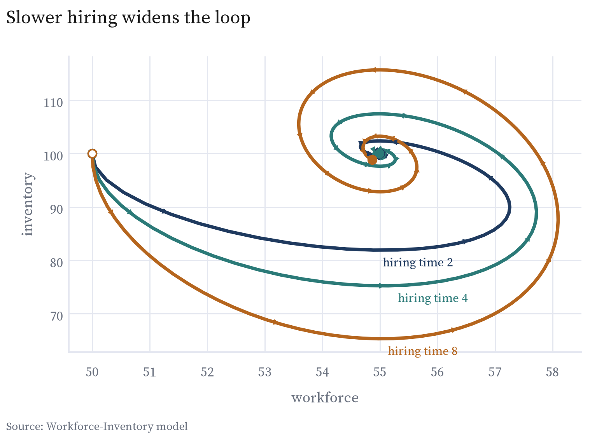
`plots.phase`. Time becomes the direction of travel. Slower hiring (orange) gives a wider spiral into the same equilibrium. A time series only implies this shape; here it is the picture.

### Policy landscape: two levers, one goal (in the library)
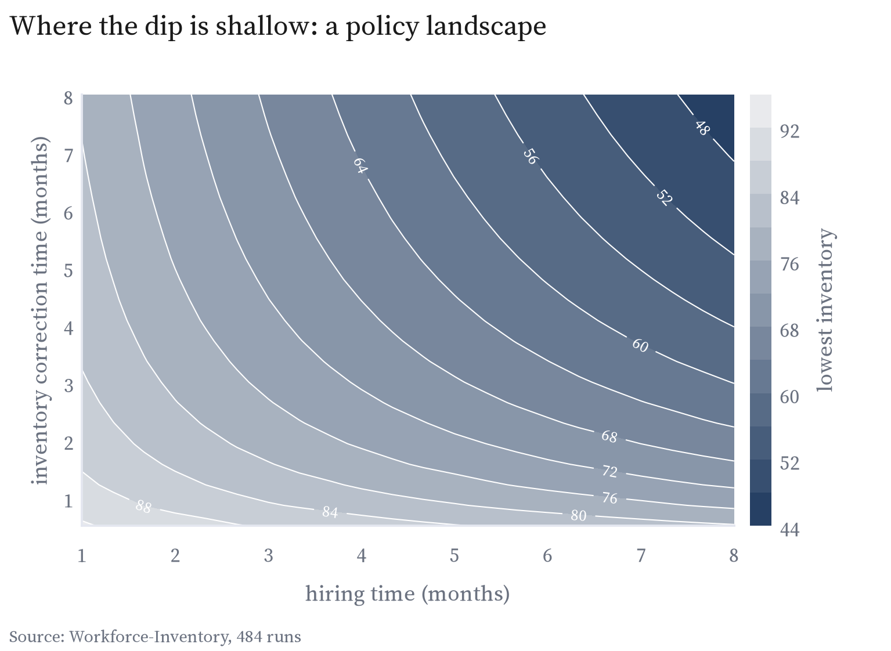
Lowest inventory over a grid of hiring time and inventory correction time, 484 runs (about a second). The contours are the policy question answered: how fast must we hire and correct to keep the dip above 80? Add the feasible region and the optimiser's path and it becomes a decision tool.

### Tornado: how far each lever can move the goal (in the library)
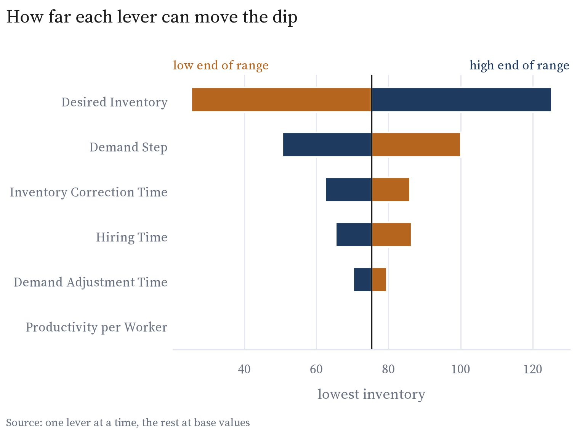
Each lever swept low to high, the others held at base. Colour says which end does what: for Desired Inventory the high end raises the dip's floor, for Demand Step the high end lowers it. Productivity per Worker has no bar at all, which is a finding.

### Every plausible future, and how they land (prototype)
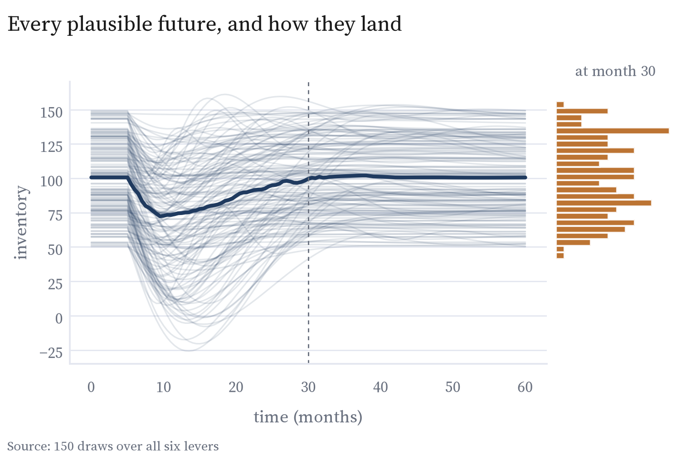
150 random draws over all six levers, the median in bold, and the spread of outcomes at month 30 on the right. Note that some draws go **below zero inventory**: the model has no rule against negative stock. Drawing the whole ensemble exposed it.

### The line changes colour with the loop in charge (prototype)
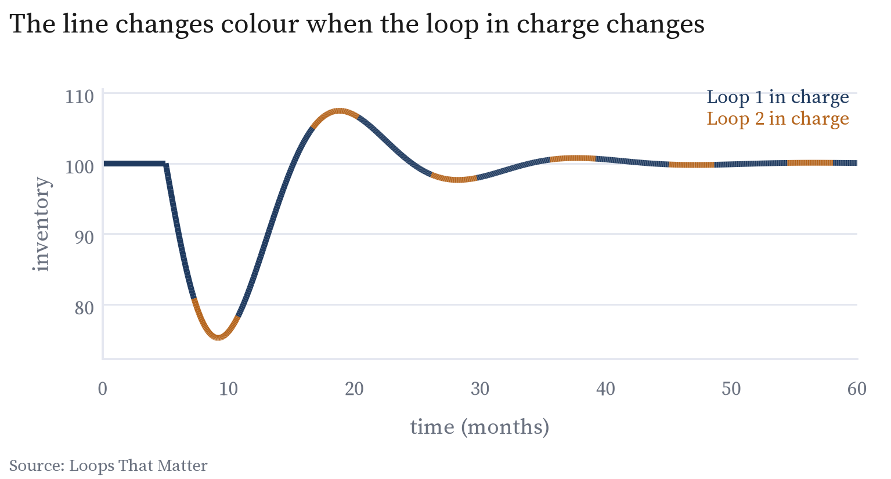
Loops That Matter folded into the behaviour itself. No separate panel to read across to: the colour of the line is the answer.

### Parallel coordinates: the recipe for an outcome (prototype)
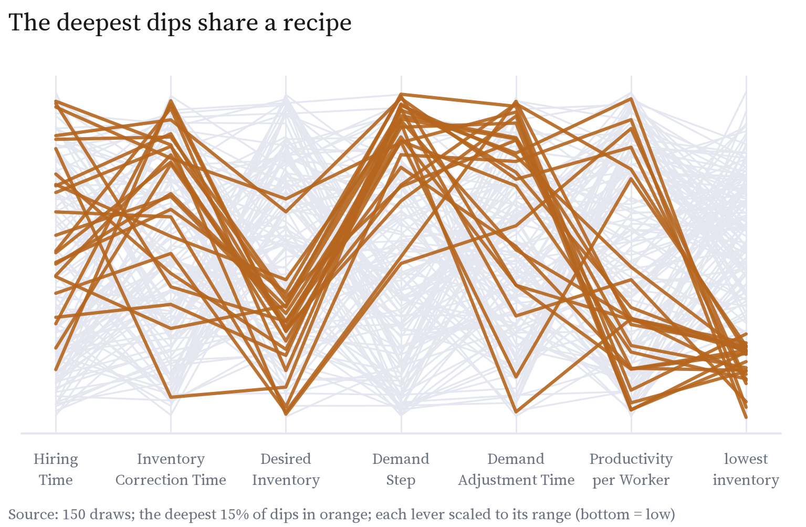
Each line is one draw. The deepest 15% of dips are in orange: low Desired Inventory and a large Demand Step. A lever's axis shows nothing at all about the others; the lines show the combination.

### Which lever matters changes with the clock (prototype)
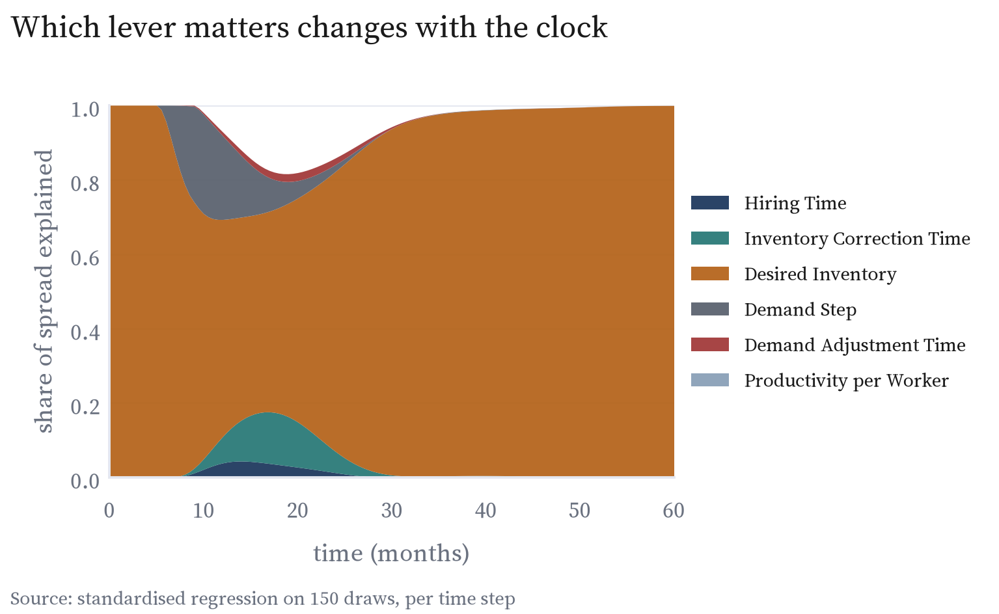
Share of the spread explained by each lever at each time step (standardised regression on the draws). Early on Demand Step explains a third; later Desired Inventory takes everything. Sobol indices give one number per lever; this gives the movie. *Caveat:* regression assumes roughly linear effects; the white gap is variance it cannot explain. A proper version would compute Sobol indices per time step.

### The behaviour in numbers (prototype)
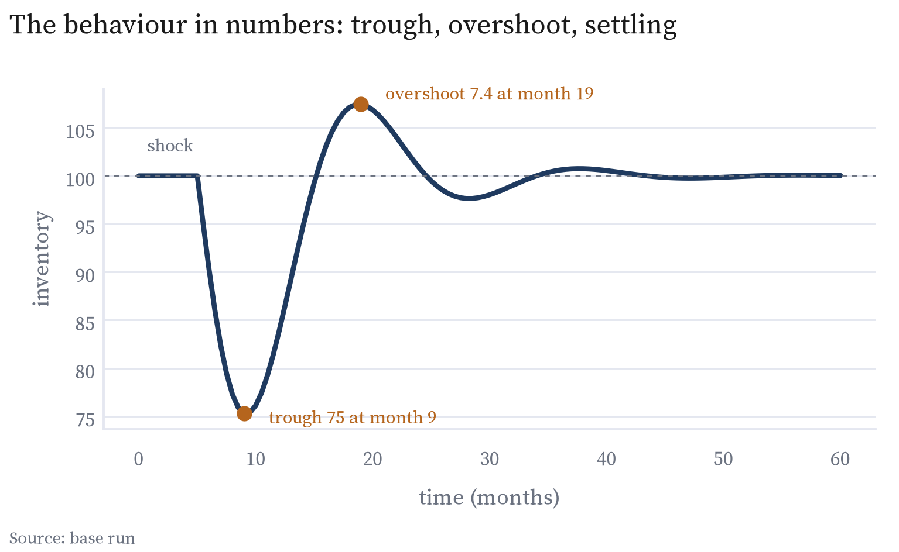
Trough, overshoot and their dates written on the line. Computed, not eyeballed. These same numbers are the features for the behaviour-mode map below.

### Small multiples (prototype)
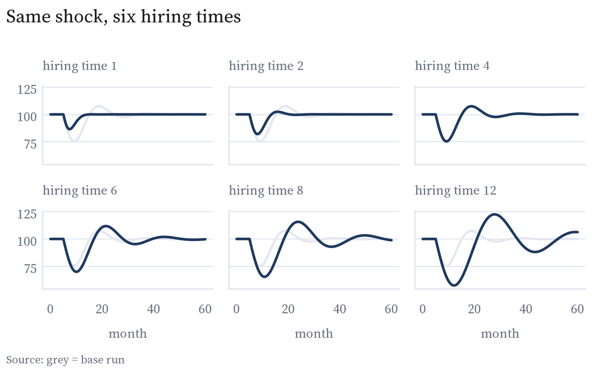
Same shock, six hiring times, shared axes, the base run in grey for reference. The cheapest honest comparison.

### Root locus: stability as a lever moves (in the library)
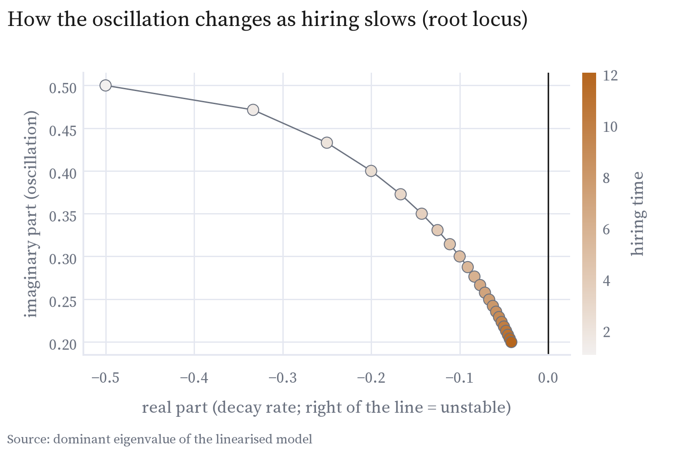
The model's dominant eigenvalue, one dot per hiring time. Moving right means slower decay; the vertical position is the speed of oscillation. This is a control-engineering chart that system dynamics rarely uses, and the app already computes the eigenvalues. A dot crossing the vertical line would mean instability.

### Levers by goals (in the library)
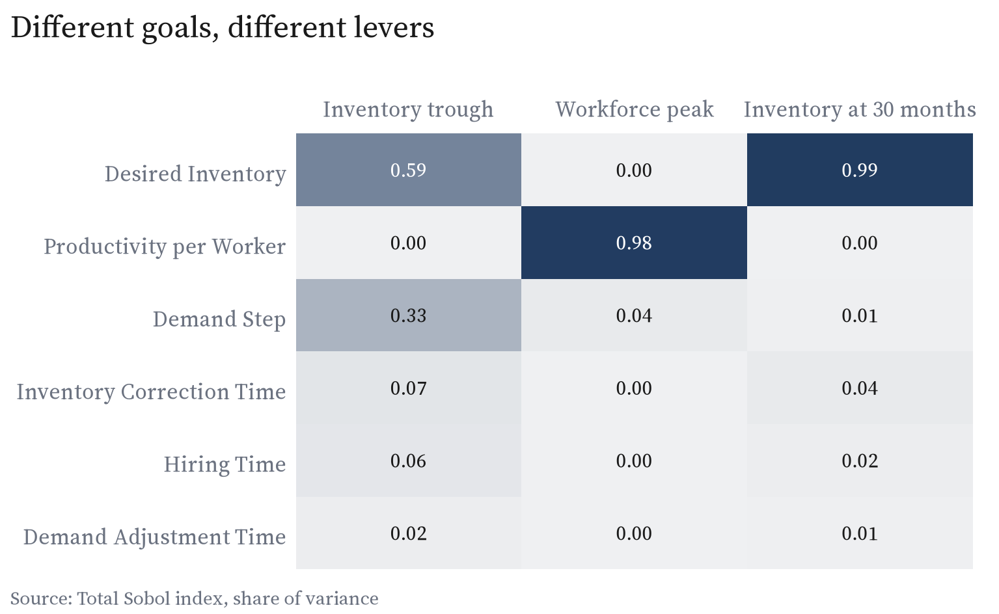
`plots.heatmap`. Different goals are driven by different levers. One glance replaces three bar charts.

### Behaviour with loop dominance underneath (in the library)
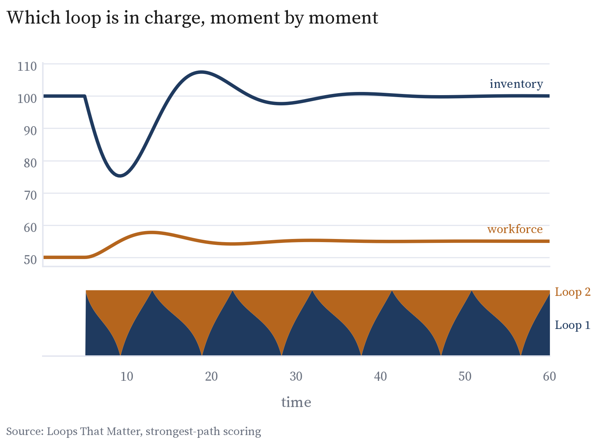
`plots.dominance_timeline`. The two loops alternate with the oscillation.

## Not drawn yet: things the field rarely does, that we could

1. **Behaviour-mode map.** A grid of two levers, each cell coloured by *what kind of behaviour* the run shows (smooth approach, overshoot, damped oscillation, sustained oscillation, collapse). A bifurcation map for modellers. The behaviour features already exist in `verify`.
2. **Bifurcation diagram.** The long-run values (or extremes) of a state against a lever. Where the line splits is where the system changes character.
3. **Counterfactual ghost.** A policy run drawn over the greyed baseline, the area between them shaded and labelled with its total ("policy gains 412 unit-months"). Every policy chapter needs it.
4. **Waterfall of causes.** Why does the goal differ between two scenarios? Split the difference among levers (a Shapley-style attribution) and draw it as a waterfall. Answers "which of the three changes did the work?".
5. **Loop and link carriers.** Instead of one score per loop, show *which link* in the loop carries the influence over time (link-score ribbons). Shows where in a loop the action is.
6. **Loop overlap matrix or chord.** Which loops share variables. Shows the structure that explains why removing one variable changes two loops.
7. **Model against data, with residuals.** Reference mode overlay, a residual strip underneath, uncertainty band from the ensemble. Needs real data per case; we will not invent any.
8. **Reduction audit chart.** Original against reduced model, per goal: the two fans overlaid and a difference strip. Makes "the reduction is safe" visible instead of a table.
9. **Pareto front across goals.** Policies as points in goal space (cost against stability), the front highlighted, each point labelled by its lever values. `recommend` already returns the Pareto set.
10. **Living diagram.** Mini charts (sparklines) drawn *inside* the stock and flow diagram's cards, so the structure and the behaviour are one picture.
11. **Animated phase portrait** for slides: the trajectory drawn as time runs. Not for the printed book.
12. **Interactive explorer** (sliders on levers, charts redraw). A browser tool built on d3 or the app itself; not the book.

## Design rules (what makes these read as one family)
- Title is a statement, set flush left; direct labels instead of legend boxes; one hairline grid; palette from the style file (`stock` navy for the focus, `aux` ochre for the thing to notice, grey for context).
- Grey context, colour for the point. The base run, the other draws, the non-deep dips go grey.
- Say what is computed under the figure (source line): number of runs, method.

## Using the library
`python/dynamist/plots.py` (see [Model-API](Model-API.md)): `sobol`, `morris`, `dominance`, `fan`, `phase`, `response`, `heatmap`, `dominance_timeline`, `landscape`, `tornado`, `root_locus`, with `use_style("book.style.json")` to share fonts and colours with the diagrams. The prototypes above are one script; `landscape`, `tornado` and `root_locus` are now functions too, with the sweeps that feed them (`grid`, `tornado_rows`, `eigen_path`); the other prototypes are still in the script.

## Flow views: where a quantity goes

The figures below are drawn from a small SEIR model with waning immunity ([`seir_waning.mdl`](../book/examples/charting/seir_waning.mdl), our own toy model, 10,000 people). It has a cycle on purpose: recovered people lose immunity and return to Susceptible. The script is [`flows.py`](../book/examples/charting/flows.py). The Sankey is in the library and exact; the board, ring and sequence are still rough (see "Known problems" under each).

### Sankey across stocks: how a quantity distributes (and moves)
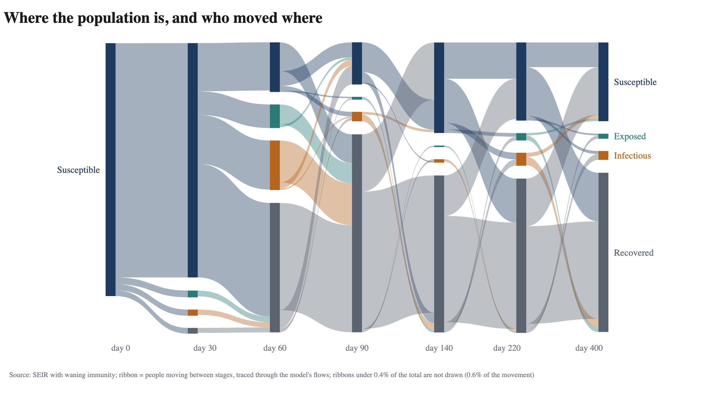
Stocks are stacked at several moments; ribbons show how many moved between stocks in the interval, coloured by where they came from. The teal ribbons reaching the grey Susceptible column are waning immunity, the loop closing. A Sankey fits only a **conserved** quantity moving between stocks (people, money, material, carbon); the app knows which flow joins which stock, so it can be drawn automatically. Prices, ratios or indices cannot be drawn this way.
**How it is made exact.** `plots.trace(model)` tags every stock's contents at the start of each interval and follows the tags through the model's own flows, one Euler step at a time: a flow moves tagged amounts out of its source stock in proportion to what is there, and they arrive in the destination. This assumes what a stock-and-flow model already assumes, that what is in a stock is interchangeable. Because the tags follow the engine's own steps, the traced amounts add up to the engine's stocks to rounding, and the function **refuses to draw** if they do not (RK4 runs, non-negative clipping, delays that remember who arrived first). Clouds become "entered from outside" and "left the model" ribbons. Two earlier attempts were dropped: a hand-drawn matplotlib version (tangled, and its ribbon split was fitted rather than traced) and the `sankeyflow` package (labels collided on this many columns).

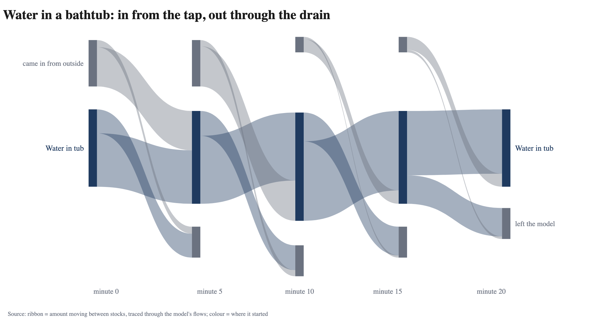
An open model (the bathtub lesson): the grey ribbons on top entered through the tap, the ribbons rising on the right left through the drain. Water that arrived in one interval can leave in the next; the picture says so.

`plots.sankey(model, out, slices=None, n_slices=8, order=None)` draws it with plotly's Sankey layout (a d3-style engine that places and orders the nodes, so we do not hand-draw ribbons); the amounts underneath are the exact traced ones. It needs `plotly` and `kaleido` (kaleido exports the image and needs Chrome installed). We place the nodes ourselves (stocks keep the same row in every column, a grey bar on top for what came in from outside and one below for what left) so that every word sits outside the ribbons: stock names in the margins, the moments underneath; ribbons under 0.4% of the total are left out and the source line says how much movement that is. Output is a picture; unlike the matplotlib charts it is not guaranteed byte-identical between runs. `plots.flow_network` lists the stocks and the flows between them; `plots.trace` returns the numbers (ribbon sizes per interval) for a table or another chart. Tested on the SEIR cycle and on the open bathtub (`python/test_plots.py`).

### Board of stages with arrows (kanban for a simulation)
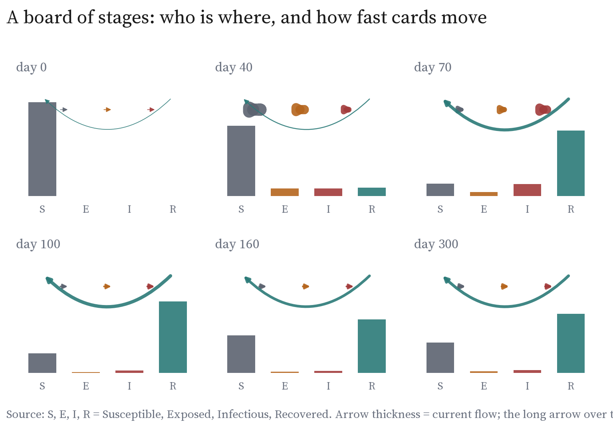
Columns are the stages (stocks), bar height is how many are there, arrow thickness is the current flow between stages, one panel per moment. Read left to right it shows work moving through; the long arrow over the top is the return path, so the circularity is on the page. This is a **compartment or state-transition diagram with the contents shown**: the same idea as a kanban board, with the flow rate on each arrow.
*Known problems:* arrows at the first panel are tiny and the thick ones overlap the bars; bars share one scale so the small stages vanish (a log or per-stage scale would help).

### The cycle itself
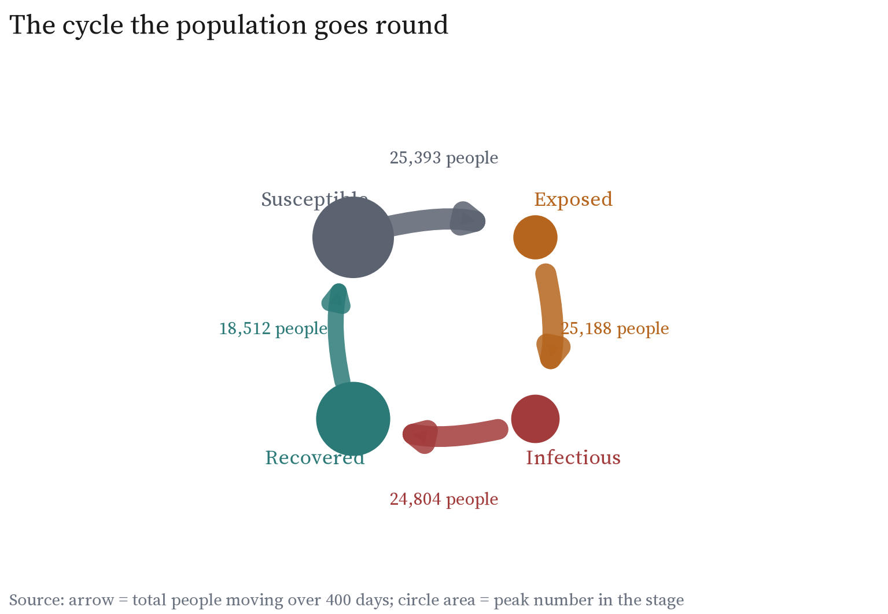
Stages on a ring, arrows sized by the total number that moved over the run, circles by the peak number in each stage. It answers "what does this system keep doing?" at one glance. *Known problems:* the arrowheads are blobs (arrow geometry needs a proper routine), labels collide with circles.

### Sequence diagram: how a change spreads, and where the loops close (in the library)
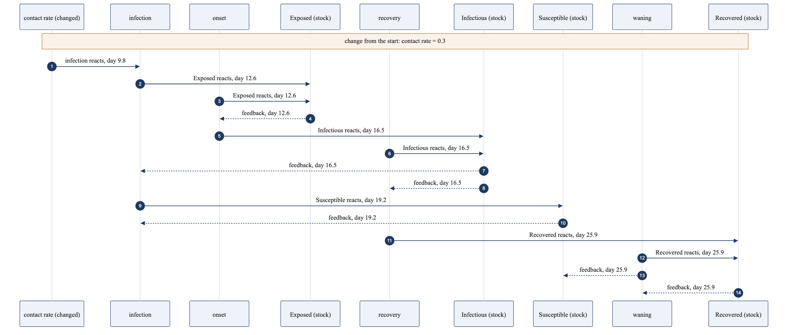
A UML-style sequence diagram drawn by Mermaid (`mmdc`). The changed input (here the contact rate, cut from 0.45 to 0.30) is the first lifeline, on the left; each variable that reacts is a lifeline, stocks marked. Solid arrows run from cause to effect along the model's own links, in the order the effects first differ from the base run by more than 1% of their range, each labelled with the day. **Dashed arrows are the links that close a feedback loop**: the cause reacts later than the effect, so the arrow returns to an earlier lifeline. The order is measured, not assumed: infection first (day 9.8), then exposed and onset, infectious and recovery, susceptible, and last recovered and waning. Variables that do not react (here the conserved total population) are listed in a note.

`plots.sequence(model, {"contact rate": 0.30}, out)` writes SVG, PNG or PDF; `plots.sequence_text` returns the Mermaid text, and `plots.reaction_order` the first-reaction day of every variable. It needs the Mermaid command line tool (`npm install -g @mermaid-js/mermaid-cli`, which uses Chrome). On a model with dozens of variables the diagram becomes long; the next step is to limit it to the variables on the paths between the changed input and a chosen output. A sequence diagram of messages between *modules* (UML in the strict sense) has not been tried.

### Budget Sankey: where does it all end up, scenario against scenario (in the library)
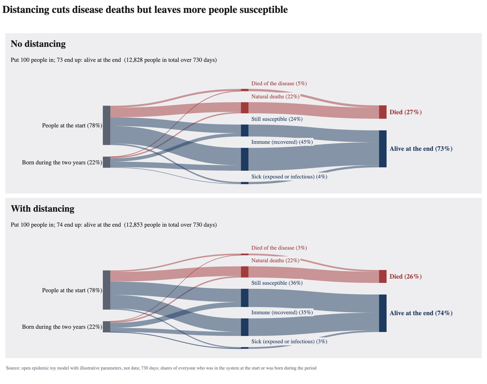
A different question from the over-time Sankey, in the style of Our World in Data's energy charts: *put 100 units in; where do they go?* A quantity enters (what is in the system at the start, plus what is born or pumped in during the period), splits into channels (the flows that carry it out, or the stock where it ends up), and the channels are grouped into outcomes. One shaded panel per scenario, shares in percent of everything put in, so panels compare directly. All text sits outside the ribbons: sources on the left, outcomes on the right, channel names in the gap above each bar. Here: an open epidemic toy model ([`epidemic_open.mdl`](../book/examples/charting/epidemic_open.mdl), illustrative parameters, not data) with and without distancing over two years. Disease deaths fall from 4.5% to 3.4% of everyone in the system; the share still susceptible rises from 24% to 36%; the share alive barely changes (73% and 74%). The picture says what a headline would hide.

`plots.budget(model, scenarios, channels, groups, out, boundary=None, window=None, sources=None, headline=None)`: `scenarios` is `[(title, {lever: value})]`; `channels` maps a channel name to the outflows that carry it away (or `"end:<Stock>"` for what remains in a stock); `groups` maps an outcome to a colour (`"loss"`, `"good"`, `"neutral"` or a hex) and its channels. It refuses a channel set that leaves any outcome uncovered. `boundary` limits the system to chosen stocks, so a bookkeeping stock (for example "Catch to date", which only mirrors Harvest) does not double count. The amounts are traced exactly through the model's flows (`plots.trace` now gives per-flow detail, and accepts `boundary` and `overrides`); the script that draws the figure is [`budget.py`](../book/examples/charting/budget.py).

## Added after a literature and tool search

- **Animated loops on the diagram** (LoopX, Schoenberg and colleagues, [arXiv 1909.01138](https://arxiv.org/pdf/1909.01138)): causal loop and stock and flow diagrams drawn from the equations, with link and loop strength animated as the simulation runs, so dominance shifts can be watched. We already compute the scores (`dyn dominance`); the missing piece is drawing them on the diagram, frame by frame. For the book: a row of frames, loop thickness and colour set by relative score at each moment.
- **Dominance overlaid on behaviour** (Loops That Matter, [arXiv 1908.11434](https://arxiv.org/pdf/1908.11434)): the paper's own "behaviour over time graphs that mix loop dominance and model variables". Our `dominance_timeline` and the coloured line are this.
- **Scenario discovery** ([RAND working paper WR-557](https://www.rand.org/content/dam/rand/pubs/working_papers/2008/RAND_WR557.pdf), PRIM): finds boxes in the lever space where the bad (or good) outcomes concentrate. Draw the boxes on the parallel-coordinates chart, or as rectangles on the policy landscape. A newer line of work clusters whole time-series outcomes (shapes of behaviour) before looking for the boxes: a **behaviour-mode atlas**.
- **Sankey caution.** One source ([Wikipedia](https://en.wikipedia.org/wiki/Sankey_diagram)) describes Sankey diagrams as directional-flow pictures for energy, material and cost accounts; the sources do not combine them with accumulation or feedback. That matches what the prototype showed: the stocks are the columns, and the ribbons are only well defined for short intervals.
- **UML and system dynamics.** A thesis on converting UML into simulation models includes sequence diagrams next to stock-and-flow diagrams, but I only saw its table of contents, so I cannot say what it concludes.

## More ideas from this round (not drawn)
- **Vector field phase plane** with nullclines, for two-stock models: arrows show where the state is pushed from any point, so one picture predicts every trajectory.
- **Regime map**: lever against lever, regions coloured by behaviour mode (growth, S-curve, oscillation, collapse); the boundaries are the tipping points.
- **Regret chart**: for each policy, how much worse than the best policy it is under each scenario. The robust choice is the one with small regret everywhere.
- **Causal tracing strip**: pick one moment where the behaviour changes and show, step by step upstream, which variables changed first (the sequence view, turned into a drill-down).
- **Stage board for non-conserved models**: when the quantity is not conserved, show the board with levels only, no Sankey.
