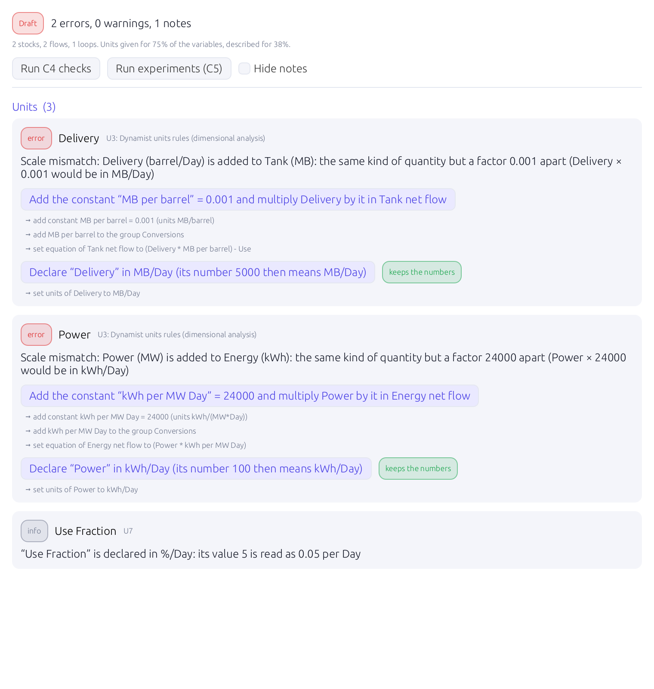
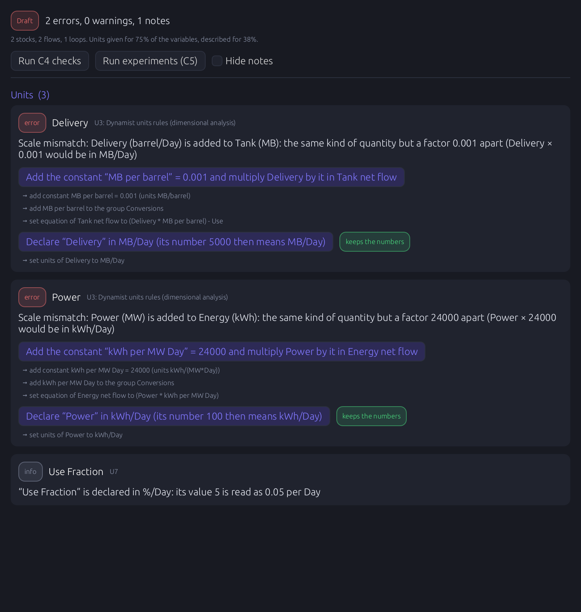

# Model health

The Model health panel shows what the [model doctor](Model-Doctor.md) found in the model you have open, and lets you fix it. Open it from **Check, Model health** in the ribbon, from the model menu, or by clicking the gate badge at the right end of the status bar.

The dark theme looks like this:

## What it shows

- **The gate.** A badge says where the model stands. Draft: there are errors. Review: no errors, but warnings remain. Publish: no errors and no warnings. The same badge sits in the status bar; hover it for the meaning.
- **The summary line.** Stocks, flows, loops, and how many variables have units and a description.
- **Findings, grouped by family:** Definition (S), Graph (G), Units (U), Formulation (F), Numerical (N), Initialisation (I), Experiments (X), Calibration (C), Reproducibility (R), Purpose (P). Within a family, errors come first.
- **Each finding** has a severity badge (error, warning, info), the variable it is about (click it to select it on the diagram), the rule id with its source citation, and the message. A finding found only by the interval analysis and not yet seen in a run carries a "can: not confirmed by a run" tag; run the C4 checks or the experiments to see whether it really happens. A finding with no fix shows the doctor's general hint for its kind.
- **Fixes.** One button per fix, with a line under it for every edit it makes, for example `add constant MB per barrel = 0.001 (units MB/barrel)` and `set equation of Delivery to ...`. A fix that leaves every number of the run as it is carries a "keeps the numbers" tag. Clicking a fix applies it as one step in the history: undo takes it back. The quick checks then run again at once.

## When it runs

- Stages C1 to C3 (names, graphs, units, signs and intervals) run again 300 ms after the last edit, so typing does not slow the app. On a big model they run on a worker thread.
- **Run C4 checks** (base run, eigenvalues, time step halving) and **Run experiments (C5)** run only when you ask, in the background. The panel shows a spinner while they run and adds their findings to the list. If you edit the model afterwards, the panel says those results are from before the edit.

## The units trap

The model in `core/tests/data/units_trap.mdl` has a delivery in barrels per day going into a tank in thousand barrels, a percent written as 5, and a power in MW going into an energy in kWh. The panel opens at Draft with two units errors, each with a first fix that adds an exact conversion constant (`MB per barrel = 0.001`, and the MW to kWh per day factor 24000), and one info note about the percent.

## Making the screenshots

`DYN_WRITE_IMG=wiki/img cargo test --release -p dynamist --lib health_panel_screenshots` writes both pictures. They differ a little between platforms, so the test writes them only when the variable is set.
