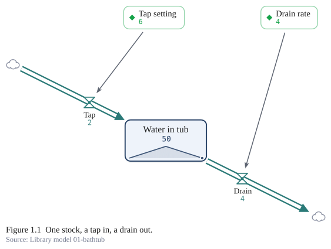
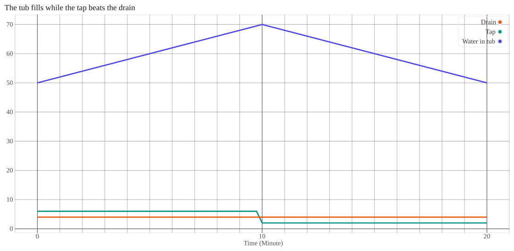

# Lesson 1: The bathtub

*Level: beginner. Skill: stock and flow. Needs: nothing. Model: `library/lessons/01-bathtub.sdm`.*

## The question

A tub holds 50 litres. The tap pours in 6 litres a minute for ten minutes, then is turned down to 2; the drain takes out 4 a minute all the time. What happens to the water?

## The model

One **stock**, *Water in tub* (the box): what has built up. Two **flows** (the pipes with valves): *Tap* fills it, *Drain* empties it. Two constants, *Tap setting* and *Drain rate*, set the flows. The rule of every stock and flow model is one line: **the stock changes by inflow minus outflow**, so the stock is the running total of the net flow.

## What to click or call

1. Open the model and press **Run**.
2. Click *Water in tub*: its equation is just the starting value, 50. A stock has no formula for its level; only its flows change it. Click *Tap* and *Drain* to see their equations.
3. Drag the *Drain rate* slider and watch the line move.
4. From a script: `m.run(series=["Water in tub"], every=1)` returns the level at every step.

## What you should see

The tub rises from 50 to a peak of **70** litres at minute 10, because the tap (6) beats the drain (4) by 2 a minute for 10 minutes. Then the tap drops to 2, below the drain, so the tub falls by 2 a minute and is back at **50** at minute 20.

Notice: the water peaks at the moment the *net flow* changes sign, not when the flow is biggest. The level lags the flows; it is their accumulation.

## Check yourself

1. Before running, predict the water at minute 20 if you set *Drain rate* to 6. Then run it.
2. Set *Tap setting* to 10. What is the peak, and when?

**Answers.** 1) For ten minutes tap and drain are equal (6 and 6), so the level stays at 50; then the net flow is 2 − 6 = −4 a minute for ten minutes, ending at **10**. 2) 50 + (10 − 4) × 10 = **110** litres, at minute 10.

## Next

Lesson 2 closes the loop: what if a flow depends on the stock it fills? [Births and deaths](02-population-loops.md).
