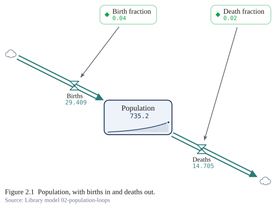
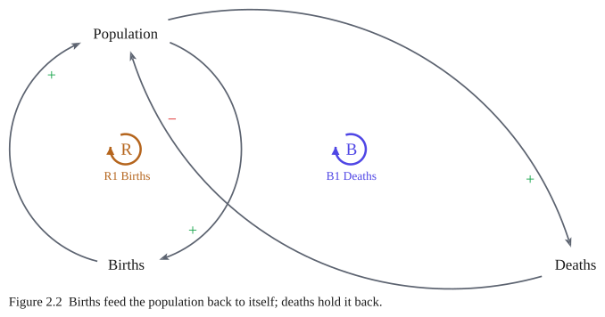
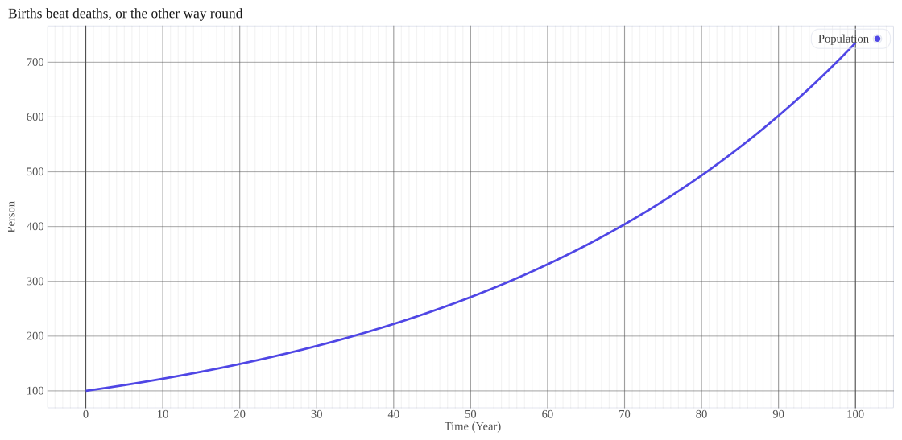

# Lesson 2: Births and deaths

*Level: beginner. Skill: feedback loops. Needs: [lesson 1](01-bathtub.md). Model: `library/lessons/02-population-loops.sdm`.*

## The question

Why does a population grow when births exceed deaths, and what does each loop do on its own?

## The model

*Population* starts at 100. *Births* = Population × *Birth fraction* (0.04 a year); *Deaths* = Population × *Death fraction* (0.02 a year). Each flow depends on the stock it feeds or drains. That is **feedback**: a closed chain of cause and effect.

*R1 Births* is **reinforcing**: more people, more births, more people. *B1 Deaths* is **balancing**: more people, more deaths, fewer people. A loop is reinforcing if it has an even number of minus signs, balancing if odd.

## What to click or call

1. Run the model. Open the **Causal loops** sheet to see the loops, or call `m.loop_ids()` (it lists `R1` and `B1`).
2. Open the **Scenarios** sheet, or `dyn chart … --scenarios all`: the library model defines one scenario, *Deaths win* (Death fraction 0.05).
3. Change *Birth fraction* and *Death fraction* with the sliders and watch which way the line bends.

## What you should see

With births at 4% and deaths at 2% the net growth is 2% a year: population goes from 100 to **735.23** in 100 years (compound growth, 100 × e² is about 739; the small gap is the step size). With deaths at 5% the balancing loop wins and the population shrinks to **36.74**.

Each loop alone is simple: R grows exponentially, B decays exponentially. What the population does depends on which is stronger, and that is the whole idea of loop dominance (lesson 5).

## Check yourself

1. Which *Death fraction* keeps the population exactly at 100?
2. With *Birth fraction* 0.02 and *Death fraction* 0.02, is it growth, decline or nothing? Is it a stable balance?

**Answers.** 1) **0.04**, where births equal deaths: the run ends at 100.0. 2) Nothing: the population stays at **100.0**. It is a balance, but not a goal-seeking one: nudge the population and nothing pulls it back. Goal-seeking needs a loop that responds to a gap, which is lesson 3 and 4's subject.

## Next

[A shipment delay](03-delays.md): what happens when an effect arrives late.
