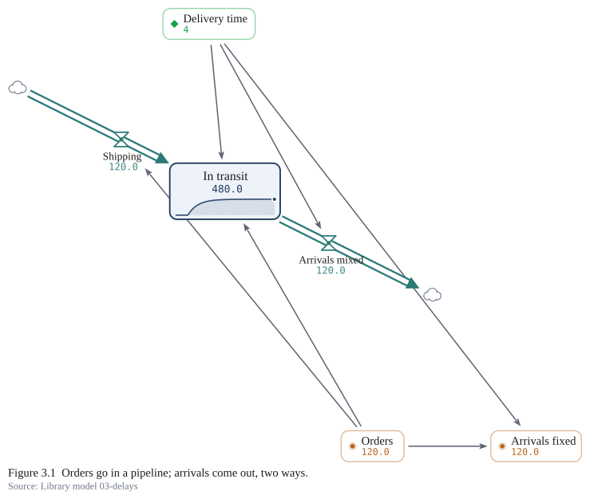
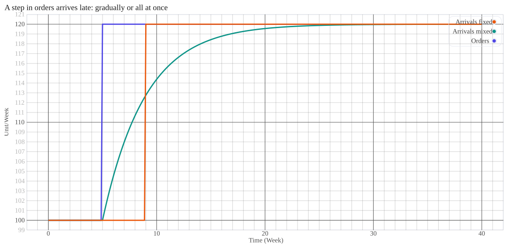

# Lesson 3: A shipment delay

*Level: beginner. Skill: delays. Needs: [lesson 1](01-bathtub.md). Model: `library/lessons/03-delays.sdm`.*

## The question

Orders step up from 100 to 120 a week at week 5. Goods take about 4 weeks to arrive. When do arrivals catch up, and does the kind of delay matter?

## The model

*In transit* is a stock: goods on the road. *Shipping* puts goods in as soon as they are ordered. Two ways to take them out:

- **First-order delay** (*Arrivals mixed*): arrivals = In transit ÷ *Delivery time*. Shipments are mixed together; the more on the road, the more arrive.
- **Fixed delay** (*Arrivals fixed*): `DELAY(Orders, Delivery time, exact=True)`. Every shipment takes exactly the delivery time, like a conveyor belt.

## What to click or call

1. Run and select *Arrivals mixed*, then *Arrivals fixed*; chart them with *Orders*.
2. Change *Delivery time* to 8 and run again.
3. Call: `m.run(series=["In transit"], overrides={"Delivery time": 8})`.

## What you should see

The fixed delay does nothing until week **9** (5 + 4), then jumps to 120 at once. The mixed delay starts moving at week 5 and approaches 120 smoothly: it reaches 110 at week **7.75** and 119 only at week **16.88**; it never quite finishes, it closes a fixed share of the gap each moment.

The stock tells the cost of the delay: *In transit* settles at **479.99**, in effect orders × delivery time (120 × 4 = 480). That is the goods you must pay for before they are of any use.

## Check yourself

1. Set *Delivery time* to 8. How many goods end up in transit, and when do mixed arrivals reach 110?
2. Which kind of delay is right for a ship crossing the ocean, which for a pile of mail?

**Answers.** 1) **958.05** (close to 120 × 8 = 960), and 110 is reached at week **10.62**: a longer delay is slower in every respect and ties up proportionally more material. 2) A ship is a fixed delay (each cargo takes the same time); mail that is read in any order, or a population of units wearing out at random, is nearer a first-order delay. Real delays sit between the two.

## Next

[Hiring and stock](04-workforce-oscillation.md): put a delay inside a balancing loop and see what it does.
