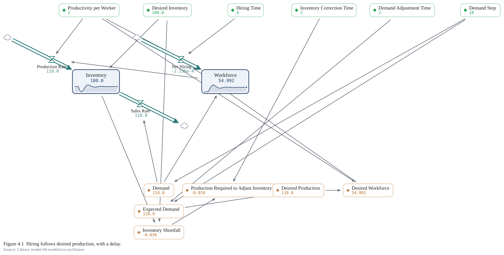
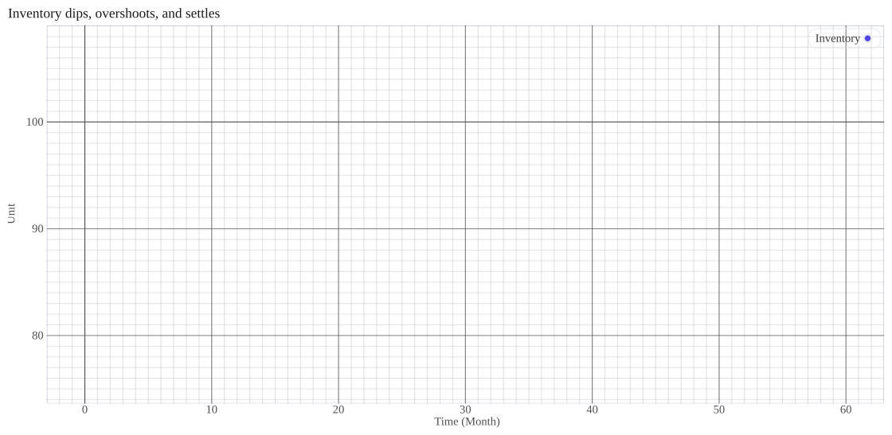
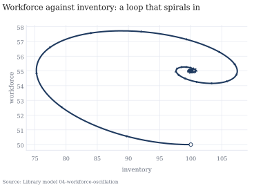
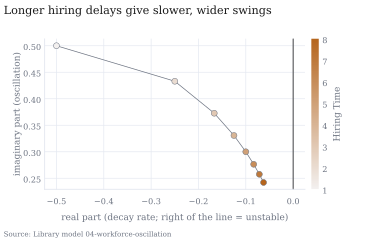

# Lesson 4: Hiring and stock, and why things oscillate

*Level: intermediate. Skill: oscillation. Needs: [lesson 2](02-population-loops.md) and [lesson 3](03-delays.md). Model: `library/lessons/04-workforce-oscillation.sdm`.*

## The question

A firm keeps a stock of goods at 100 and hires or fires to keep it there. Demand steps up by 10% at month 5. Why do the workforce and the inventory swing before they settle?

## The model

Two stocks: *Inventory* (filled by *Production Rate* = Workforce × productivity, drained by sales) and *Workforce* (changed by *Net Hiring*, which closes the gap to *Desired Workforce* over *Hiring Time*). The firm's rule is sensible: produce what is expected to be sold, plus a share of the inventory shortfall. Every link is a goal-seeking balancing loop, but there are **delays**: hiring takes months, and production takes workers.

## What to click or call

1. Run and chart *Inventory* and *Workforce*.
2. Change *Hiring Time* from 4 to 8, then to 1, and compare.
3. Python: `plots.eigen_path(m, "Hiring Time", [1, …, 8])` linearises the model and returns how fast it swings and decays for each setting; `plots.root_locus` draws it.

## What you should see

Demand rises and sales exceed production, so inventory falls from 100 to a trough of **75.23** at month **9.19**. Hiring catches up; the workforce overshoots (peak **57.72**) and inventory rebounds past the target, to **107.45** at month **18.81**, then settles at 100. The workforce goes from **50** to **54.99**, the new demand level (110 ÷ 2 = 55) without ever having been told it.

Plotting workforce against inventory shows the spiral: each swing is smaller than the one before, a **damped oscillation**.

**Why it happens.** The loops try to close a gap, but the correction takes time to work. By the time the gap is closed the correction is still in motion, so it overshoots, and the opposite correction begins. A balancing loop with a delay can oscillate; the longer the delay, the more.

Each dot is the model's slowest-decaying oscillation for one *Hiring Time*. At 1 month the swing has period 2π ÷ 0.50 = about 12.6 months and decays at 0.50 a month (real part −0.50); at 8 months it is slower (imaginary part 0.24, period about 26 months) and barely decays (−0.06). All dots are left of the line: stable, but longer delays mean longer, wider swings.

## Check yourself

1. Predict, then run: does a *Hiring Time* of 8 make the inventory trough shallower or deeper? And a *Hiring Time* of 1?
2. Which of the two stocks overshoots its final level more in relative terms?

**Answers.** 1) The longer delay gives a **deeper** trough, **65.31**; a hiring time of 1 gives a shallower one, **86.37**. 2) Inventory: it first falls 25% below target and then rises about 7% above; the workforce overshoots 57.72 against 54.99 (5%).

## Next

[Growth runs into a limit](05-limits-to-growth.md): what happens when a reinforcing loop meets a balancing one.
