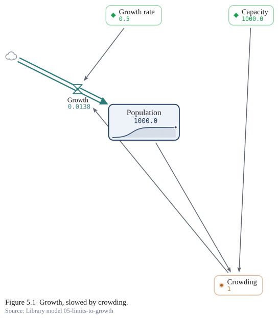
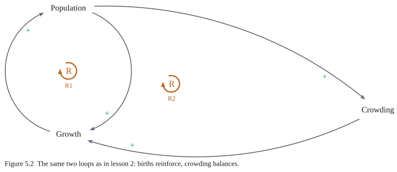
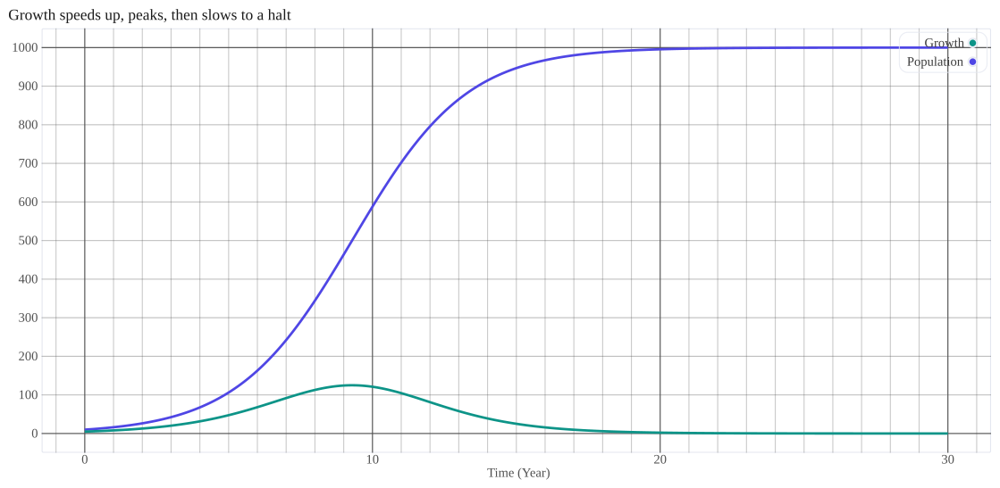
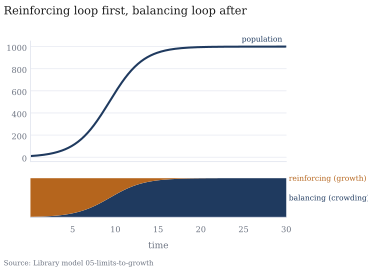

# Lesson 5: Growth runs into a limit

*Level: intermediate. Skill: growth limits and loop dominance. Needs: [lesson 2](02-population-loops.md). Model: `library/lessons/05-limits-to-growth.sdm`.*

## The question

Why does growth that starts exponential slow down and level off, and where does it change?

## The model

*Growth* = Population × *Growth rate* × (1 − *Crowding*), where *Crowding* = Population ÷ *Capacity*. When the place is empty, each person adds growth at the full rate (a reinforcing loop). As it fills, the factor (1 − crowding) shrinks and growth is throttled (a balancing loop). Population starts at 10, capacity is 1000.

## What to click or call

1. Run and chart *Population* and *Growth*.
2. Double *Capacity* to 2000 and compare.
3. Open the loop dominance view, or `m.dominance()`; for the chart, `plots.dominance_timeline(run, series, csv, out)` where the CSV is from `dyn dominance FILE --csv scores.csv`.

## What you should see

The population climbs in an S: slowly at first, quickly in the middle, then flat at **999.97** (the capacity, 1000, is the end state). Growth speeds up, peaks at **125** a year at year **9.31** when the population is **502.7**, and then falls. Half the capacity is where the curve is steepest.

The lower band shows each loop's share of the influence. The reinforcing loop dominates early; the balancing loop takes over at year **9.38**, almost exactly at the steepest point. Over the whole run, the balancing loop is dominant **69%** of the time and the reinforcing loop **31%**. Behaviour changes when dominance changes.

## Check yourself

1. Double *Capacity* to 2000. Predict the end value, the peak growth and whether it happens earlier or later.
2. Set *Growth rate* to 0.25. Is the population at the capacity by year 30?

**Answers.** 1) The end value is **1999.89** (near 2000) and peak growth doubles to **249.99**, at half the capacity; it comes later, at year **10.69** instead of 9.31, because it takes longer to get to a bigger half. 2) Not within the thirty years: it reaches **947.46**, still approaching 1000. Growth rate sets the *pace*, capacity sets where it stops.

## Next

[A fishery: testing a policy](06-fishery-policy.md): take the same structure and ask how hard to push it.
