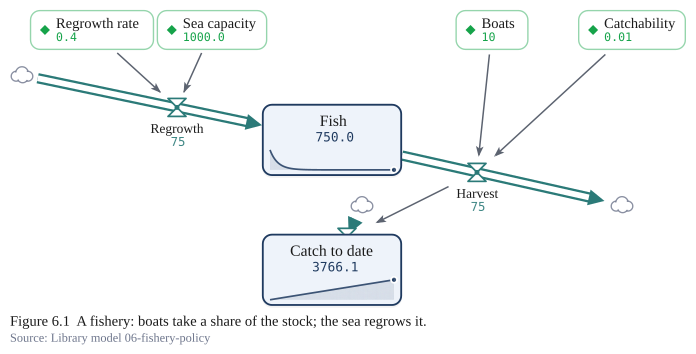
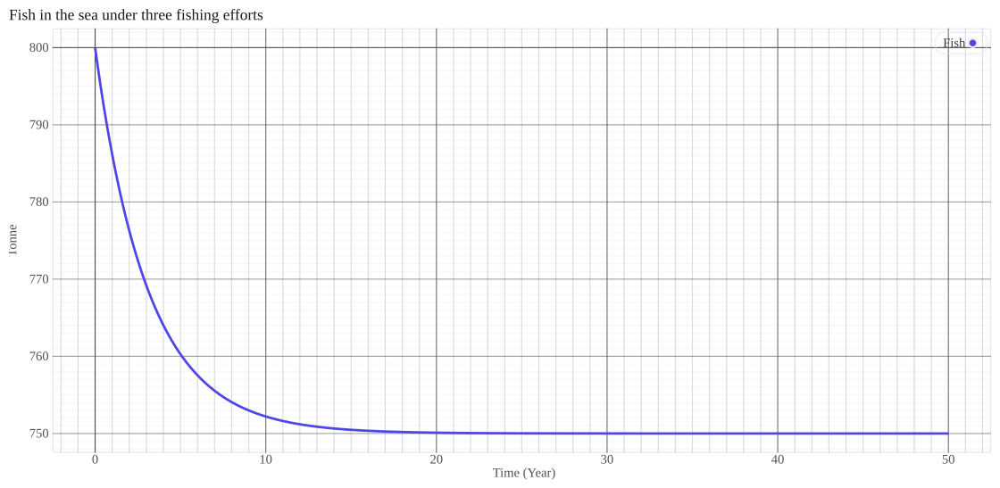
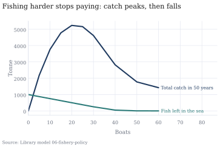
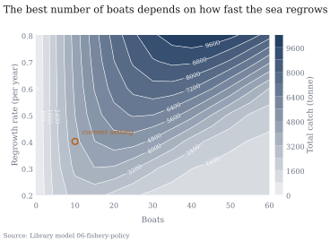

# Lesson 6: A fishery, and testing a policy

*Level: intermediate. Skill: policy testing. Needs: [lesson 5](05-limits-to-growth.md). Model: `library/lessons/06-fishery-policy.sdm`.*

## The question

Boats take fish; the sea grows them back. How many boats bring home the most fish over fifty years, and what is the cost?

## The model

*Fish* regrow as in lesson 5 (*Regrowth* slows as the sea fills up). *Harvest* = *Boats* × *Catchability* × Fish: the more fish, the bigger each catch. *Landings* add the harvest to *Catch to date*. The **policy lever** is *Boats* (10 now). The model's manifest marks four levers with ranges and two goals: *Total catch* (the final Catch to date, wanted high) and *Fish left* (the final stock, wanted high).

## What to click or call

1. Run the base case (10 boats) and the two scenarios, *Few boats* (5) and *Many boats* (40), on the **Scenarios** sheet.
2. Open **Optimize**, pick *Total catch*, let it vary *Boats*. Or call a **sweep**: `plots.sweep(m, "catch to date", "last", [{"Boats": b} for b in boats])`.
3. For two levers at once: `plots.grid(...)` returns the goal over *Boats* and *Regrowth rate*; `plots.landscape(...)` draws it.

## What you should see

Few boats leave a full sea; many boats nearly empty it.

Over fifty years, the total catch in tonnes for each number of boats we tried:

| Boats | 0 | 5 | 10 | 15 | 20 | 25 | 30 | 40 | 50 | 60 |
|---|---|---|---|---|---|---|---|---|---|---|
| Total catch | 0 | 2176 | 3766 | 4780 | **5234** | 5159 | 4614 | 2821 | 1774 | 1421 |
| Fish left | 1000 | 875 | 750 | 625 | 500 | 375 | 251 | 47 | 1 | 0 |

The catch rises with effort up to **20 boats** (best of those tried, 5 234 tonnes), then falls: more boats than that take the stock down faster than it regrows, so they catch less in total and leave nothing in the sea. At 20 boats half the stock (500 tonnes) is left; the price of the extra catch beyond 10 boats is a smaller stock.

The best number of boats depends on the world: with a slow-growing sea (regrowth 0.2) the best of the numbers tried is **10** boats; with a fast one (0.8) it is **40**. The best catch anywhere on this grid is **10 233** tonnes. A policy that is best in one world can be poor in another, which is why policies are tested over a *range* of the uncertain numbers, not at one setting.

## Check yourself

1. The ministry wants at least 600 tonnes left in the sea after fifty years. What is the most boats allowed?
2. What is the catch if the ministry's limit is met with the most boats?

**Answers.** 1) Fish left is 625 at 15 boats and 500 at 20, so the limit lies between: **16** boats leaves exactly **600.0**, 17 leave 575. (The steady stock is 1000 × (1 − 0.025 × boats).) 2) **4 915** tonnes, against 5 234 at 20 boats: the rule costs about 6% of the best catch and keeps 100 tonnes more fish in the sea.

## Next

[Which lever matters?](07-workforce-what-matters.md): when there are many numbers to vary, how do you find the few that matter?
