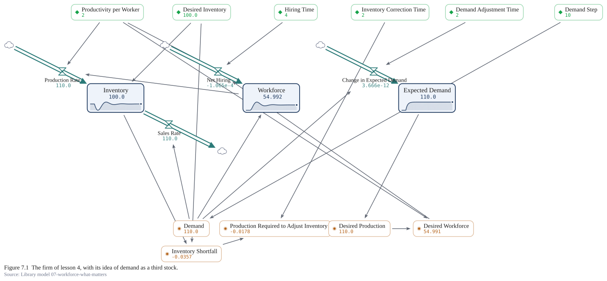
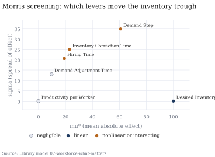
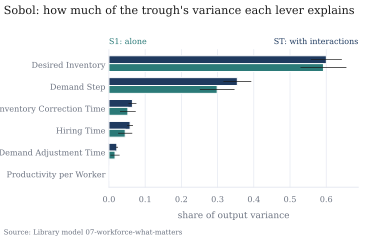
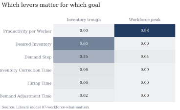
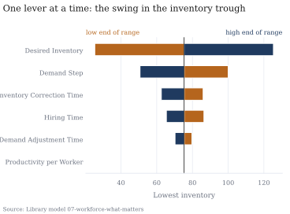

# Lesson 7: Which lever matters?

*Level: advanced. Skill: finding what matters. Needs: [lesson 4](04-workforce-oscillation.md) and [lesson 6](06-fishery-policy.md). Model: `library/lessons/07-workforce-what-matters.sdm`.*

## The question

The firm of lesson 4 has six numbers a manager could change. Which ones decide the outcome, and which can be left alone? (The question only has an answer *for a goal*, so the goals are declared first.)

## The model

The firm of lesson 4 with the firm's idea of demand (*Expected Demand*) as a third stock. The manifest holds the six **levers**, each with the range it may take, and three **goals**: *Inventory trough* (the lowest inventory, wanted high), *Workforce peak* (wanted low) and *Inventory at 30 months* (wanted near 100). See [Find what matters](../Find-What-Matters.md).

## What to click or call

Three steps, from cheapest to most careful:

1. **Screen** (Morris): `m.screen(trajectories=20)` or `dyn screen FILE`. About 140 runs; ranks levers by how far they move a goal and flags the ones that interact.
2. **Importance** (Sobol): `m.importance(goals=["Inventory trough"], samples=512)` or `dyn importance FILE`. Hundreds of runs; says what share of the goal's variance each lever explains alone (`s1`) and with its interactions (`st`).
3. **Plot** them: `plots.morris`, `plots.sobol`, `plots.heatmap`, and for a plain check one lever at a time `plots.tornado_rows` with `plots.tornado`.

## What you should see

Base value of the *Inventory trough* is **75.33**.

Morris: *Desired Inventory* moves the trough most (mean effect 100.0, linear), then *Demand Step* (60.77, interacting), *Inventory Correction Time* (23.01), *Hiring Time* (19.22) and *Demand Adjustment Time* (9.67, negligible by the default threshold). *Productivity per Worker* has an effect of **0.0**.

Sobol agrees: *Desired Inventory* explains **60%** of the trough's variance (total index 0.60), *Demand Step* 0.35; *Hiring Time* and *Inventory Correction Time* 0.06 each, *Demand Adjustment Time* 0.02 and *Productivity per Worker* 0.00. Two levers decide the trough; four barely do, over these ranges.

The tornado confirms the order with the simplest test, moving each lever across its range alone (swing in the trough: Desired Inventory 100.0, Demand Step 49.34, Inventory Correction Time 23.39, Hiring Time 21.02, Demand Adjustment Time 9.44, Productivity 0.00).

**Mind the goal.** The heatmap shows the same levers against the other goal. For *Workforce peak*, *Productivity per Worker* has a total index of **0.98**: the workforce is production divided by productivity. A lever that does nothing for one goal can be everything for another, and the *shape* of the swings (lesson 4: the delays) matters less than the level here, because the ranges chosen move levels more than timing. Read the answer as "over these ranges, for this goal".

Which loops are in charge? Three balancing loops take turns, with shares of time dominant of 0.38, 0.32 and 0.22: no single loop runs the model.

## Check yourself

1. You must fix four of the six levers to keep a study cheap, for the *Inventory trough* goal. Which four?
2. Why is it wrong to drop *Productivity per Worker* from the model for all purposes?

**Answers.** 1) Fix the four with the smallest effects: *Productivity per Worker*, *Demand Adjustment Time*, *Hiring Time* and *Inventory Correction Time* (total indices 0.00, 0.02, 0.06, 0.06). Keep *Desired Inventory* and *Demand Step*. 2) Because it decides another goal: its total index for *Workforce peak* is 0.98. Screening answers a question about declared goals; change the goal and you must screen again.

## Where next

You can now read a stock and flow model, find its loops and delays, explain oscillation and S-shaped growth, test a policy and find the levers that matter. Continue with the [book outline](../../book/Book-Outline.md), the [figure library](../Figure-Library.md), and the [charting catalogue](../Charting-Ideas.md), which shows more ways to draw the results.
